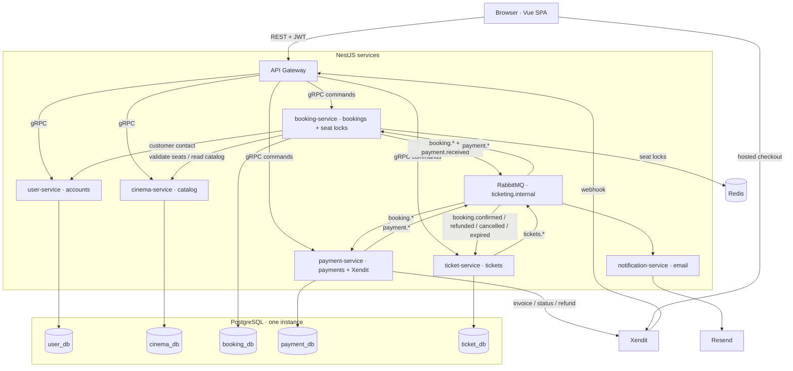

# CinX — Cinema Ticket Booking

## 1. Project Overview

CinX is a portfolio project covering seat selection, payments, ticket issuance, and cinema administration. It explores concurrent seat reservations and payment coordination across NestJS services, with a Vue frontend.

The core implementation combines five-minute Redis locks, PostgreSQL uniqueness constraints, and Xendit payment confirmation.

<details>
<summary>Run locally</summary>

Requires Node.js 22.9+, pnpm, and Docker Compose.

```bash
cp .env.example .env
# Set JWT_SECRET to at least 32 characters.
pnpm install
pnpm dev
```

`pnpm dev` starts PostgreSQL, Redis, and RabbitMQ, waits for readiness, then runs the apps with local connection settings. Local PostgreSQL uses `postgres` as its password.

- App: http://localhost:5173
- API health: http://localhost:3000/api/v1/health
- Observability: run `pnpm infra:up`, then open http://localhost:3001.

Payments require Xendit credentials. Webhooks require a public gateway URL and `XENDIT_WEBHOOK_TOKEN`. Email requires `RESEND_API_KEY`; otherwise, notifications run in logging-only mode.

To populate demo data, set `SEED_ADMIN_PASSWORD` to at least 12 characters in `.env`, then run these commands in another terminal:

```bash
PG_HOST=127.0.0.1 PG_PASSWORD=postgres pnpm --filter @ticketing/user-service exec node --env-file=../../.env --import tsx src/scripts/seed-admin.ts
pnpm --filter @ticketing/cinema-service seed
```

The catalog seed deletes existing catalog data and uses fixed showtime dates. Use a demo database and update showtimes through the admin pages before booking.

The domain split introduced `booking_db` and `payment_db`. There are no migrations, so after pulling this change reset the local database volume once:

```bash
docker compose -f infra/docker-compose.yml down -v
docker compose -f infra/docker-compose.yml up -d --wait
```

Then seed the catalog again. `pnpm dev` starts the same infrastructure if it is not already running.

</details>

## 2. Features

- **Browsing:** movies, showtimes, prices, and seat maps with availability fetched from the backend.
- **Accounts:** JWT authentication and personal booking history.
- **Reservations:** up to eight seats per booking, with a five-minute payment window.
- **Payments:** Xendit hosted checkout, webhook confirmation, and payment-status synchronization.
- **Tickets and refunds:** ticket lookup by code, unpaid booking cancellation, and provider-backed refunds.
- **Notifications:** booking confirmations and payment receipts through Resend.
- **Administration:** movie, theater, and showtime management with role checks and schedule-overlap validation.

The landing-page seat map and countdown are demos. The booking flow uses backend data.

## 3. Tech Stack

| Area                       | Technologies                                                       |
| -------------------------- | ------------------------------------------------------------------ |
| Frontend                   | Vue 3, TypeScript, Vite, Pinia, Vue Router, Naive UI, Tailwind CSS |
| Backend                    | NestJS, REST gateway, gRPC, Protocol Buffers                       |
| Data and locking           | PostgreSQL 18, TypeORM, Redis, `redlock`                           |
| Messaging and integrations | RabbitMQ, Xendit, Resend                                           |
| Observability              | OpenTelemetry, OTel Collector, Tempo, Prometheus, Grafana          |
| Tooling                    | pnpm workspaces, Turborepo, Docker Compose, GitHub Actions         |
| Testing                    | Jest, Vitest, Playwright, k6                                       |

## 4. Architecture

The browser calls one REST gateway. The gateway routes requests over gRPC and combines catalog data with booking availability. Each data-owning service uses its own database within one PostgreSQL instance.



### Booking flow

1. **Select:** the gateway combines seat geometry from `cinema-service` with availability from `booking-service`.
2. **Reserve:** `booking-service` validates seats with `cinema-service`, acquires Redis locks, and saves a `PENDING` booking plus seat snapshots. A unique `(showtime_id, seat_id)` constraint rejects conflicting seat records.
3. **Pay:** the gateway validates the hold with `booking.PrepareCharge`, then asks `payment-service` to create a Xendit invoice. A webhook or status-sync request checks the payment result.
4. **Confirm:** `payment-service` publishes `payment.settled`. `booking-service` records `paid_at` and publishes `booking.confirmed`; `ticket-service` issues tickets and publishes `tickets.issued`; `booking-service` then moves the booking to `CONFIRMED`. Notification events are emitted along the way.
5. **Expire or refund:** `booking-service` runs expiry, confirmation-retry, and refund-retry crons. Late settlements are refunded automatically, and tickets are voided only after `payment.refunded`.

Services send telemetry through OTel Collector. Tempo stores traces, Prometheus collects metrics, and Grafana displays both.

Details: [API contract](./docs/openapi.yaml) · [Data model](./docs/ERD.md) · [Domain terminology](./CONTEXT.md) · [Load-testing scenarios](./benchmark/README.md)

## 5. Trade-offs

| Decision                       | Benefit                                                    | Current limitation                                                                           |
| ------------------------------ | ---------------------------------------------------------- | -------------------------------------------------------------------------------------------- |
| Microservices and gRPC         | Explicit service boundaries and contracts                  | More processes and coordination than a modular monolith                                      |
| Database per service           | Separate data ownership                                    | No cross-database foreign keys or shared transaction; one PostgreSQL instance                |
| Redis locks and DB constraints | Coordinate reservations and enforce seat-record uniqueness | One Redis instance; reservations fail when it is unavailable                                 |
| Asynchronous payments          | Follow the provider's payment and refund results           | Provider webhooks can be late; status sync and retry crons converge the state                |
| RabbitMQ domain events         | Decouple booking, payment, and ticket services             | Durable queues use manual ack, but there is no transactional outbox or dead-letter queue yet |
| Seat-map fallback              | Keep the layout visible during booking-service failures    | Seats may appear available; the server validates them again when reserving                   |
| TypeORM `synchronize`          | Quick schema changes during development                    | No versioned migration workflow yet                                                          |

The Compose setup targets development and demonstration. High availability and production capacity remain unverified.

## 6. Future Actions

- Add a transactional outbox and a dead-letter queue with bounded retries.
- Exercise refund and late-settlement paths against Xendit in staging.
- Replace schema synchronization with migrations and test backup recovery.
- Expand failure and concurrency tests; publish reproducible benchmark results.
- Mark unknown seat availability clearly and complete accessibility and mobile checks.
