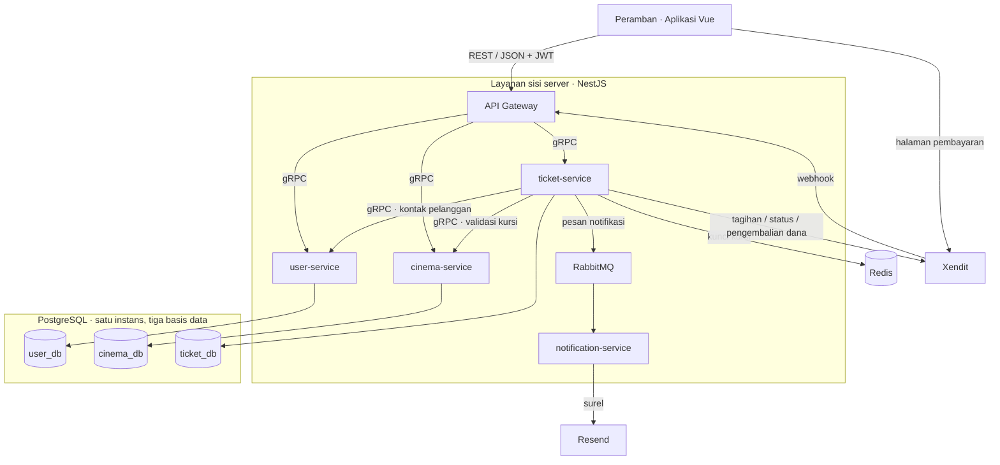

# CinX — Pemesanan Tiket Bioskop

CinX membantu pelanggan memilih kursi dan memesan tiket bioskop melalui pembayaran Xendit. Admin mengelola film, studio, dan jadwal tayang melalui aplikasi yang sama.

[Ringkasan](#1-ringkasan-proyek) · [Fitur](#2-fitur) · [Teknologi](#3-teknologi) · [Arsitektur](#4-arsitektur) · [Pertimbangan Desain](#5-pertimbangan-desain) · [Rencana Pengembangan](#6-rencana-pengembangan)

## 1. Ringkasan Proyek

Proyek portofolio ini mengeksplorasi alur pemesanan tiket yang melibatkan beberapa layanan. Pelanggan memilih jadwal dan kursi, lalu membayar pesanan. Sistem mencadangkan kursi selama proses pembayaran dan menerbitkan tiket setelah menerima konfirmasi pembayaran.

CinX berfokus pada penanganan permintaan kursi yang bersamaan, pembagian tanggung jawab layanan, dan penyelarasan status pemesanan dengan penyedia pembayaran. Sistem menggunakan Redis untuk mengunci kursi sementara. Batasan unik pada PostgreSQL mencegah dua catatan kursi dengan pasangan jadwal dan kursi yang sama.

Repositori ini mencakup antarmuka pelanggan dan admin, layanan sisi server, konfigurasi infrastruktur, serta pengujian. Docker Compose memudahkan pengembang menjalankan dan mempelajari sistem. Konfigurasi saat ini belum menyediakan redundansi layanan untuk menjaga ketersediaan saat terjadi gangguan. Proyek ini juga belum menyertakan bukti kapasitas untuk penggunaan produksi.

<details>
<summary>Menjalankan proyek</summary>

Siapkan Node.js 22.9 atau versi lebih baru, pnpm, serta Docker dengan Compose. Salin konfigurasi awal, lalu isi `JWT_SECRET` dengan sedikitnya 32 karakter. Gunakan kredensial Xendit untuk pembayaran dan `RESEND_API_KEY` untuk mengirim surel.

```bash
cp .env.example .env
pnpm install
pnpm dev
```

Perintah `pnpm dev` menjalankan PostgreSQL, Redis, dan RabbitMQ, lalu menunggu ketiganya siap sebelum menjalankan aplikasi di komputer lokal. Perintah ini juga memuat `.env` dan menyesuaikan alamat koneksi untuk penggunaan lokal. Kata sandi PostgreSQL lokal mengikuti konfigurasi infrastruktur, yaitu `postgres`.

Untuk mengisi katalog dan membuat akun admin, jalankan perintah berikut di terminal lain setelah infrastruktur siap:

```bash
# Isi SEED_ADMIN_PASSWORD minimal 12 karakter di .env terlebih dahulu.
PG_HOST=127.0.0.1 PG_PASSWORD=postgres pnpm --filter @ticketing/user-service exec node --env-file=../../.env --import tsx src/scripts/seed-admin.ts
pnpm --filter @ticketing/cinema-service seed
```

Skrip pengisian katalog menghapus data katalog sebelumnya dan memakai tanggal tetap untuk jadwal contoh. Jalankan skrip hanya pada basis data demo. Sesuaikan jadwal melalui halaman admin sebelum mencoba pemesanan.

Untuk menjalankan seluruh layanan melalui Docker, isi juga `PG_PASSWORD` pada `.env`, lalu jalankan:

```bash
pnpm docker:up
pnpm docker:seed
```

Pilih salah satu mode agar port aplikasi dan infrastruktur tidak berbenturan. Jalankan `pnpm infra:up` jika ingin memakai perangkat pemantauan lokal.

| Akses                    | URL bawaan                          |
| ------------------------ | ----------------------------------- |
| Aplikasi                 | http://localhost:5173               |
| REST API                 | http://localhost:3000/api/v1        |
| Pemeriksaan layanan      | http://localhost:3000/api/v1/health |
| Grafana, jika dijalankan | http://localhost:3001               |

Xendit mengirim pemberitahuan status pembayaran melalui webhook, yaitu permintaan HTTP ke alamat aplikasi. Sediakan URL publik menuju gateway, isi `XENDIT_WEBHOOK_URL` dan `XENDIT_WEBHOOK_TOKEN`, lalu daftarkan webhook melalui `pnpm --filter @ticketing/ticket-service xendit:webhook`. Kredensial Xendit menentukan mode pembayaran. Tanpa kredensial Resend, layanan notifikasi hanya mencatat isi surel tanpa mengirimkannya.

</details>

## 2. Fitur

### Pelanggan

- **Katalog dan jadwal:** pelanggan melihat film, jadwal tayang, harga, serta denah kursi. Aplikasi mengambil status ketersediaan kursi saat memuat denah.
- **Akun:** pelanggan mendaftar, masuk, dan melihat riwayat pemesanannya. Sistem menggunakan JWT untuk memverifikasi identitas pengguna.
- **Reservasi kursi:** pelanggan memilih paling banyak delapan kursi per pemesanan. Sistem mencadangkan kursi selama lima menit sebelum reservasi kedaluwarsa.
- **Pembayaran:** pelanggan membayar melalui halaman tagihan Xendit. Sistem memperbarui status melalui webhook atau meminta status terbaru ke Xendit ketika konfirmasi belum tiba.
- **Tiket:** pelanggan melihat tiket setelah sistem mengonfirmasi pemesanan dan mencari tiket berdasarkan kode.
- **Pembatalan dan pengembalian dana:** pelanggan membatalkan pemesanan yang belum lunas atau mengajukan pengembalian dana untuk pemesanan yang sudah terkonfirmasi. Sistem mengikuti hasil dari penyedia pembayaran untuk memperbarui status pengembalian dana.
- **Notifikasi surel:** layanan notifikasi mengirim tiket dan bukti pembayaran kepada pelanggan.

### Admin

- Admin mengelola film, studio, dan jadwal tayang. Sistem memeriksa hak akses admin sebelum menerima perubahan.
- Sistem memeriksa benturan jadwal pada studio yang sama saat admin membuat atau mengubah jadwal.

Halaman pengenalan menampilkan contoh denah kursi dan hitung mundur. Saat pelanggan memesan tiket, aplikasi memakai data jadwal dan status pemesanan dari server.

## 3. Teknologi

| Bagian              | Teknologi dan peran                                                                                                                 |
| ------------------- | ----------------------------------------------------------------------------------------------------------------------------------- |
| Antarmuka pengguna  | Vue 3, TypeScript, Vite, Vue Router, Pinia, Naive UI, dan Tailwind CSS                                                              |
| Layanan sisi server | NestJS; REST untuk klien, gRPC dan Protocol Buffers untuk komunikasi internal                                                       |
| Penyimpanan         | PostgreSQL 18 dan TypeORM; basis data terpisah untuk pengguna, katalog, dan pemesanan                                               |
| Penguncian kursi    | Redis dan pustaka `redlock`                                                                                                         |
| Pesan asinkron      | RabbitMQ untuk pesan notifikasi                                                                                                     |
| Integrasi eksternal | Xendit untuk tagihan dan pengembalian dana; Resend untuk surel                                                                      |
| Pemantauan          | OpenTelemetry, OTel Collector, Tempo, Prometheus, dan Grafana                                                                       |
| Pengembangan        | pnpm workspaces, Turborepo, Docker Compose, GitHub Actions                                                                          |
| Pengujian           | Jest untuk layanan sisi server, Vitest untuk antarmuka, Playwright untuk pengujian alur lengkap (E2E), dan k6 untuk pengujian beban |

<details>
<summary>Perintah pemeriksaan</summary>

```bash
pnpm build
pnpm lint
pnpm test
pnpm --filter @ticketing/ticket-service test:integration
pnpm --filter web e2e:install
pnpm --filter web e2e
```

Jalankan infrastruktur lokal sebelum menguji integrasi. Lihat konfigurasi E2E di [`apps/web/e2e`](./apps/web/e2e) serta kebutuhan dan skenario k6 di [`benchmark/README.md`](./benchmark/README.md). Jalankan pengujian pada lingkungan tujuan untuk memeriksa hasilnya; keberadaan skrip saja tidak membuktikan semua skenario berhasil.

</details>

## 4. Arsitektur

### Gambaran sistem

Peramban mengakses API melalui satu gateway, yaitu pintu masuk permintaan ke server. Gateway meneruskan permintaan ke layanan terkait melalui gRPC. Gateway juga menggabungkan data, misalnya denah studio dari layanan katalog dan ketersediaan kursi dari layanan pemesanan.



| Komponen               | Tanggung jawab                                                                                                                                     |
| ---------------------- | -------------------------------------------------------------------------------------------------------------------------------------------------- |
| `gateway`              | Menerima permintaan API, memvalidasi masukan, memverifikasi JWT, memeriksa hak akses, dan menggabungkan respons; tidak memiliki basis data sendiri |
| `user-service`         | Mengelola akun, kredensial, dan peran pengguna serta menerbitkan JWT                                                                               |
| `cinema-service`       | Mengelola film, studio, kursi, jadwal, dan harga                                                                                                   |
| `ticket-service`       | Mengelola pemesanan, mengunci kursi, memproses pembayaran dan pengembalian dana, menerbitkan tiket, serta menyelaraskan status secara berkala      |
| `notification-service` | Menerima pesan pemesanan dan pembayaran, lalu mengirim surel                                                                                       |

Setiap layanan pemilik data mengakses basis datanya sendiri. Layanan merujuk data dari layanan lain melalui ID, tanpa kunci asing (_foreign key_) lintas basis data. Saat membuat pemesanan, `ticket-service` menyalin data kursi dan harga agar pemesanan tidak hanya bergantung pada katalog yang dapat berubah.

Perangkat pemantauan membantu pengembang menelusuri permintaan dan mengamati kondisi layanan. Layanan mengirim data telemetri ke **OTel Collector**. **Tempo** menyimpan jejak permintaan, **Prometheus** mengumpulkan metrik, dan **Grafana** menampilkan keduanya.

### Alur pemesanan

1. **Pilih jadwal dan kursi.** Gateway menggabungkan denah dari `cinema-service` dan ketersediaan dari `ticket-service`.
2. **Cadangkan kursi.** `ticket-service` memvalidasi kursi, memperoleh kunci Redis, lalu menyimpan pemesanan berstatus `PENDING` beserta data kursinya. Batasan unik `(showtime_id, seat_id)` menolak catatan kursi yang bertabrakan.
3. **Bayar pesanan.** Server membuat tagihan Xendit dan mengembalikan URL halaman pembayaran. Membuka halaman pembayaran atau kembali ke aplikasi belum berarti pembayaran berhasil.
4. **Konfirmasi pembayaran.** Xendit mengirim webhook melalui gateway, atau aplikasi meminta server memeriksa status terbaru ke Xendit. Jika pembayaran berhasil dan pemesanan masih valid, `ticket-service` mengubah status menjadi `CONFIRMED`, menerbitkan tiket, lalu mengirim pesan notifikasi.
5. **Tangani kedaluwarsa atau pengembalian dana.** Sistem mengakhiri pemesanan yang melewati batas waktu pembayaran. Untuk pengembalian dana, sistem memakai status `REFUND_PENDING` sambil menunggu hasil dari penyedia pembayaran. Selama proses ini, tiket tetap berlaku dan kursi tetap menjadi hak pelanggan. Pemeriksaan berkala menangani pemesanan kedaluwarsa dan pengembalian dana yang tertunda.

Kontrak API: [`docs/openapi.yaml`](./docs/openapi.yaml). Model data: [`docs/ERD.md`](./docs/ERD.md). Istilah domain: [`CONTEXT.md`](./CONTEXT.md).

## 5. Pertimbangan Desain

Setiap keputusan desain memiliki manfaat dan konsekuensi (_trade-off_). Tabel berikut merangkum pilihan serta batasan implementasi saat ini.

| Keputusan                                            | Manfaat                                                                                      | Konsekuensi / batasan saat ini                                                                                                                                                                                                  |
| ---------------------------------------------------- | -------------------------------------------------------------------------------------------- | ------------------------------------------------------------------------------------------------------------------------------------------------------------------------------------------------------------------------------- |
| Layanan terpisah (_microservices_) dengan gateway    | Memperjelas tanggung jawab dan kontrak komunikasi setiap layanan                             | Menambah proses, konfigurasi, dan titik kegagalan dibandingkan satu aplikasi dengan modul terpisah. Pendekatan ini tidak selalu lebih tepat untuk aplikasi kecil.                                                               |
| Basis data per layanan                               | Memisahkan kepemilikan data                                                                  | Tidak menyediakan kunci asing atau transaksi tunggal lintas layanan. Tiga basis data masih berbagi satu instans PostgreSQL.                                                                                                     |
| REST eksternal, gRPC internal                        | Memungkinkan peramban memakai API umum dan layanan internal memakai kontrak Protocol Buffers | Gateway menambah satu lapisan komunikasi. Pengembang perlu menyelaraskan perubahan kontrak antarlayanan.                                                                                                                        |
| Kunci Redis dan batasan unik PostgreSQL              | Membatasi perebutan kursi dan menjaga keunikan catatan kursi                                 | Sistem memakai satu instans Redis dan menolak reservasi ketika Redis tidak tersedia. Konfigurasi ini belum menyediakan mekanisme penguncian dengan beberapa simpul independen.                                                  |
| Pembayaran dan pengembalian dana asinkron            | Menyelaraskan status dengan konfirmasi penyedia pembayaran                                   | Webhook dapat terlambat sehingga sistem perlu memeriksa ulang status. Sistem tidak menerbitkan tiket untuk pembayaran setelah reservasi kedaluwarsa; kasus ini masih membutuhkan penanganan pengembalian dana lanjutan.         |
| Surel melalui RabbitMQ                               | Memisahkan pengiriman surel dari layanan pemesanan                                           | Sistem belum menjamin pengiriman ulang saat terjadi kegagalan. Sistem belum mencatat pesan dan perubahan data dalam satu transaksi (_transactional outbox_). Penerima pesan memakai `noAck` tanpa konfirmasi pemrosesan manual. |
| Tetap menampilkan denah saat layanan pemesanan gagal | Memungkinkan pelanggan melihat katalog dan bentuk studio                                     | Aplikasi dapat menampilkan kursi sebagai tersedia ketika gagal mengambil status pemesanan. Server tetap memvalidasi kursi saat pelanggan membuat reservasi.                                                                     |
| TypeORM `synchronize`                                | Memudahkan perubahan skema selama pengembangan                                               | Sistem belum mengelola perubahan skema melalui migrasi terurut untuk lingkungan produksi.                                                                                                                                       |

## 6. Rencana Pengembangan

- **Pemulihan pembayaran:** menambahkan alur penanganan pembayaran setelah reservasi kedaluwarsa, termasuk catatan pembayaran dan pengembalian dana yang memudahkan penelusuran.
- **Keandalan notifikasi:** menambahkan pencatatan pesan dalam transaksi, konfirmasi pemrosesan manual, percobaan ulang terbatas, dan antrean pesan gagal (_dead-letter queue_).
- **Pengelolaan data:** mengganti sinkronisasi skema otomatis dengan migrasi, lalu menguji pencadangan dan pemulihan basis data.
- **Pengujian kegagalan dan beban:** memperluas pengujian webhook berulang, mulai ulang layanan saat pemesanan berlangsung, gangguan Redis/RabbitMQ, dan perebutan kursi. Memublikasikan hasil uji kinerja beserta kondisi pengujiannya.
- **Pengalaman pengguna:** menandai kursi yang belum memiliki status ketersediaan terverifikasi. Melengkapi pengujian alur pemesanan dengan papan ketik, pembaca layar, AXE, dan perangkat seluler.

Daftar ini merupakan arah pengembangan, bukan fitur yang sudah tersedia.
