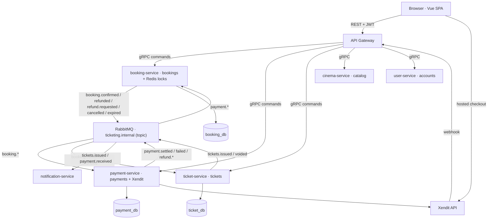

# Ticket Service Domain Split

Status: proposed

This document describes the decomposition of `apps/ticket-service` into three
services — booking, payment, and ticket — while keeping `cinema-service` as the
theater/catalog owner and leaving the public REST contract unchanged.

## Why

`apps/ticket-service` currently owns four concerns in one process and one
database:

| Concern | Current location |
| --- | --- |
| Booking aggregate | `src/bookings/*` — `Booking`, `BookingSeat`, hold/cancel/list/availability, expiry cron |
| Payment aggregate | `src/payments/*` and the `Payment` entity under `src/bookings/` |
| Ticket aggregate | `Ticket` entity and ticket issuance/lookup inside `bookings.service.ts` |
| Theater/catalog access | `src/cinema/*` — a client to `cinema-service`, which already owns theaters, seats, showtimes, and movies |

The seams are visible in the code: `BookingsService` is 1,217 lines and
orchestrates all four concerns. `ticket_db` holds `bookings`, `booking_seats`,
`payments`, and `tickets` in one schema, with cross-domain foreign keys from
`payments.booking_id` and `tickets.booking_id`. The gateway only knows one
`TicketService`, so booking, payment, and ticket RPCs share one stub.

## Decisions

| Decision | Choice |
| --- | --- |
| Theater boundary | `cinema-service` stays the theater/movie/showtime/seat owner |
| Existing data | Reset dev databases; no data migration |
| Service coordination | Pure event-driven between domains; the gateway issues commands |
| REST contract | Unchanged — `apps/web` should not need edits |
| Sync-payment | Gateway command plus eventual booking projection; the web keeps polling |
| Paid-but-unticketed | Booking stays `PENDING` with `paid_at` until `tickets.issued` arrives |
| Event bus | One topic exchange: `ticketing.internal` |

## Target architecture

No service calls another service synchronously to change payment or ticket
state. The gateway is the only command router. Booking, payment, and ticket
depend only on `@ticketing/shared` contracts; read-only calls to
`cinema-service` and `user-service` remain where the booking flow needs them.

## Domain ownership

| Domain | Service | Data | Commands |
| --- | --- | --- | --- |
| Booking | `booking-service` | `bookings`, `booking_seats`, Redis seat locks | `Hold`, `Cancel`, `Get`, `List`, `Availability`, `PrepareCharge` |
| Payment | `payment-service` | `payments` | `Charge`, `Webhook`, `SyncPaymentStatus`, `Get` |
| Ticket | `ticket-service` | `tickets` | `ListTickets`, `GetByCode`, replay `IssueTickets` / `VoidTickets` |
| Theater/catalog | `cinema-service` | unchanged | existing `CinemaService` |
| Customer | `user-service` | unchanged | existing `UserService` |

## Contracts

The single `packages/shared/proto/ticket.proto` is split into:

- `booking.proto` — hold/cancel/get/list/availability/prepare-charge.
- `payment.proto` — charge/webhook/sync/get.
- `ticket.proto` — list/get-by-code plus replay issue/void.

`packages/shared/src/contracts/ticket.ts` is split into `booking.ts`,
`payment.ts`, `ticket.ts`, and `events.ts`. The shared package also gains:

- `SERVICE_NAMES.BOOKING`, `SERVICE_NAMES.PAYMENT`.
- `GRPC_PACKAGES.BOOKING`, `GRPC_PACKAGES.PAYMENT`.
- `GRPC_PORTS.BOOKING` (50054) and `GRPC_PORTS.PAYMENT` (50055); ticket stays
  at 50053.
- `PG_DBS.BOOKING` (`booking_db`) and `PG_DBS.PAYMENT` (`payment_db`).
- `externalIdForBooking(bookingId)` (`cix-{bookingId}`).

`PrepareCharge` is a read-only booking command. It validates ownership, state,
and expiry, then returns the amount, currency, expiry, description, and user
that the gateway hands to `payment.Charge`. Booking never calls payment.

## Events

All domain events travel through the topic exchange `ticketing.internal`.

| Event | Producer | Consumer | Effect |
| --- | --- | --- | --- |
| `payment.settled` | payment | booking | mark booking paid, emit `booking.confirmed` |
| `payment.failed` | payment | booking | cancel unpaid booking, emit `booking.cancelled` |
| `payment.refund_pending` | payment | booking | keep `REFUND_PENDING` |
| `payment.refunded` | payment | booking | booking `REFUNDED`, emit `booking.refunded` |
| `payment.refund_failed` | payment | booking | revert the booking |
| `booking.confirmed` | booking | ticket | issue tickets, emit `tickets.issued` |
| `tickets.issued` | ticket | booking, notification | booking `CONFIRMED`; send ticket email |
| `payment.received` | booking | notification | send receipt email |
| `booking.refund.requested` | booking | payment | start provider refund |
| `booking.refunded` | booking | ticket | void tickets |
| `booking.cancelled` / `booking.expired` | booking | payment | expire the hosted invoice |

Queues:

- `booking.payment-events` — binds `payment.*`.
- `payment.booking-events` — binds `booking.refund.requested`,
  `booking.cancelled`, `booking.expired`.
- `ticket.booking-events` — binds `booking.confirmed`, `booking.refunded`.
- `notification.events` — binds `tickets.issued`, `payment.received`.

Domain events use durable queues and manual acknowledgement. Handlers are
idempotent. A handler that commits local state but fails to publish throws, so
the broker requeues the message and the retry republishes. Poison messages go
to a dead-letter queue after a retry limit. Notification events stay
best-effort.

`booking.confirmed` carries the seat/movie snapshot and the resolved recipient,
so ticket-service does not need to call cinema-service or user-service.
`tickets.issued` carries the ticket codes, so notification-service can send the
confirmation email without calling booking-service.

## Booking state machine

New booking columns:

| Column | Purpose |
| --- | --- |
| `paid_at` | Payment settled; waiting for ticket issuance |
| `refund_requested_at` | Refund-command retry marker |
| `tickets_issued_at` | Diagnostics and idempotency |
| `movie_title`, `theater_name`, `starts_at` | Snapshot taken at hold, so confirmation does not depend on cinema-service uptime |

| State | REST status | Availability | Expiry |
| --- | --- | --- | --- |
| `PENDING`, unpaid | `PENDING` | `HELD` | expires normally |
| `PENDING`, paid | `PENDING` | `BOOKED` | never expired |
| `CONFIRMED` | `CONFIRMED` | `BOOKED` | terminal |
| `EXPIRED` / `CANCELLED` | same | free | terminal |
| `REFUND_PENDING` | same | `BOOKED` | terminal until refund result |
| `REFUNDED` | same | free | terminal |

A paid `PENDING` booking keeps the existing confirmation page polling until
tickets exist, with no REST or web change.

## Flows

### Hold

1. Gateway calls `booking.Hold`.
2. Booking validates seats with cinema-service, takes Redis locks, and writes
   the booking, seat snapshots, and movie/theater/start snapshot.
3. Booking returns `PENDING`. No payment row is created; the `payment` summary
   is synthesized as `cix-{bookingId}`, `XENDIT`, `PENDING`.

### Pay

1. Gateway calls `booking.PrepareCharge` to validate ownership and state.
2. Gateway calls `payment.Charge` with the returned context.
3. Payment creates the Xendit invoice and returns `checkoutUrl`.
4. Gateway re-reads the booking and returns the existing `PayResult` shape.

### Webhook and sync

1. Gateway calls `payment.Webhook` or `payment.SyncPaymentStatus`.
2. Payment updates its record and emits `payment.settled` or `payment.failed`.
3. Booking consumes the event, sets `paid_at`, releases locks, emits
   `booking.confirmed` and `payment.received`.
4. Ticket-service consumes `booking.confirmed`, issues tickets idempotently, and
   emits `tickets.issued`.
5. Booking consumes `tickets.issued`, sets `CONFIRMED` and `tickets_issued_at`.
6. `sync-payment` returns the current booking projection; the web's existing
   four-second poll converges. No REST change is required.

### Cancel and refund

1. Unpaid `PENDING` → booking `CANCELLED`, emit `booking.cancelled`, release
   locks; payment expires the hosted invoice.
2. Paid or confirmed → booking optimistically sets `REFUND_PENDING` and emits
   `booking.refund.requested`.
3. Payment requests the Xendit refund and emits `payment.refund_pending`,
   `payment.refunded`, or `payment.refund_failed`.
4. Booking applies the result. `payment.refunded` sets `REFUNDED` and emits
   `booking.refunded`, so ticket-service voids the tickets.
   `payment.refund_failed` reverts the booking to its paid state.
5. A booking cron re-emits `booking.refund.requested` if
   `refund_requested_at` is older than a threshold and no result arrived.

Refund requests are idempotent: a duplicate event never creates a second
provider refund, and a duplicate `payment.refunded` is a no-op.

### Late payment

If `payment.settled` arrives for an `EXPIRED` or `CANCELLED` booking, booking
emits `booking.refund.requested` automatically. No tickets are issued and the
money is returned.

### Expiry

- The cron expires only unpaid `PENDING` bookings; paid-pending bookings are
  never expired.
- It emits `booking.expired`; payment expires the hosted invoice.
- A separate cron re-emits `booking.confirmed` for paid-pending bookings that
  never received `tickets.issued`.

## Implementation phases

1. **Shared contracts** — split protos and domain contracts; add event
   patterns, payloads, queues, exchange constants, ports, and databases.
2. **Payment service** — move the payment entity, Xendit adapter, and
   charge/webhook/sync logic; consume booking refund/cancel/expiry events;
   publish payment events; add the refund reconciliation cron.
3. **Ticket service** — slim to tickets; consume `booking.confirmed` and
   `booking.refunded`; publish `tickets.issued` and `tickets.voided`; add
   `booking_id` and `showtime_id` snapshots; expose read/replay commands.
4. **Booking service** — move booking entities, locks, and cinema/user clients;
   implement the `paid_at` state machine; consume payment and ticket events;
   publish booking and notification events; add expiry, confirmation-retry, and
   refund-retry crons.
5. **Gateway** — add booking and payment clients; keep ticket for ticket reads;
   route commands as described above; keep every REST path and response shape.
6. **Infrastructure** — add `booking_db` and `payment_db`; add the two
   services to compose, Dockerfiles, CI/CD, environment examples, and the e2e
   script; replace the fanout exchange with `ticketing.internal` topic; add a
   dead-letter queue; add a cross-database e2e cleanup script.
7. **Tests and docs** — split unit and integration tests; add event-consumer
   tests; update `README.md`, `docs/ARCHITECTURE.md`, `docs/ERD.md`, and
   `PLAN.md`; run `graphify update`.

## Acceptance criteria

- `pnpm format:check`, `pnpm lint`, `pnpm test`, and `pnpm build` pass.
- `docker compose config -q` passes.
- Demo flow works end to end: hold → pay → webhook → paid-pending →
  `tickets.issued` → `CONFIRMED` → tickets visible → cancel → refund →
  `REFUNDED` → tickets voided → seats resellable.
- No service imports another service's source; each depends only on
  `@ticketing/shared`.
- REST paths and response shapes are unchanged, so the Vue app needs no edits.
- A lost `payment.settled` recovers through `sync-payment`; a lost
  `booking.confirmed` recovers through the booking confirmation-retry cron.

## Out of scope

- Splitting or renaming `cinema-service`.
- Preserving existing `ticket_db` rows.
- A transactional outbox. Idempotent handlers, requeue, and retry crons cover
  the current scale; an outbox can be added later.
- Web application changes.

## Risks

| Risk | Mitigation |
| --- | --- |
| `sync-payment` returns a projection that has not applied the event yet | The web already polls every four seconds; the gateway can optionally poll booking for about one second |
| Event ordering races between settle, cancel, and expiry | Idempotent handlers, automatic refund for late settlement, idempotent refunds |
| Ticket-service unavailable at confirmation | Booking stays paid-pending, the event stays queued, and the UI keeps polling |
| RabbitMQ exchange type change | Reset the dev broker; document the migration for other environments |
| More moving parts | Two extra services and a real event bus; this is the cost of the requested decoupling |
